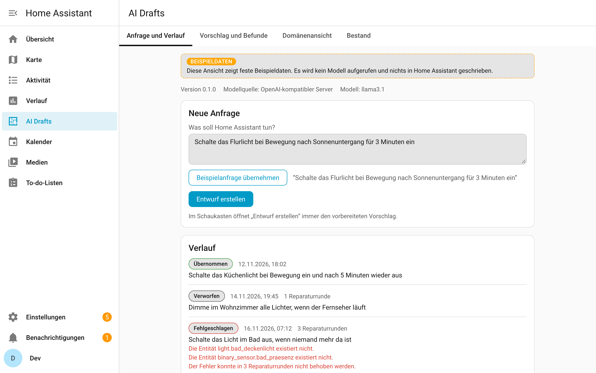
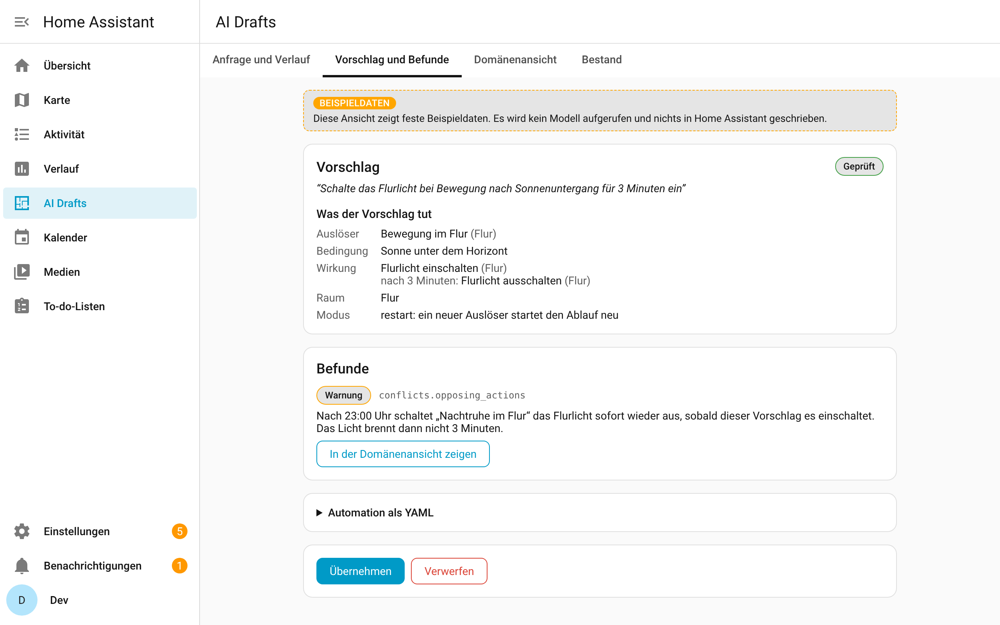
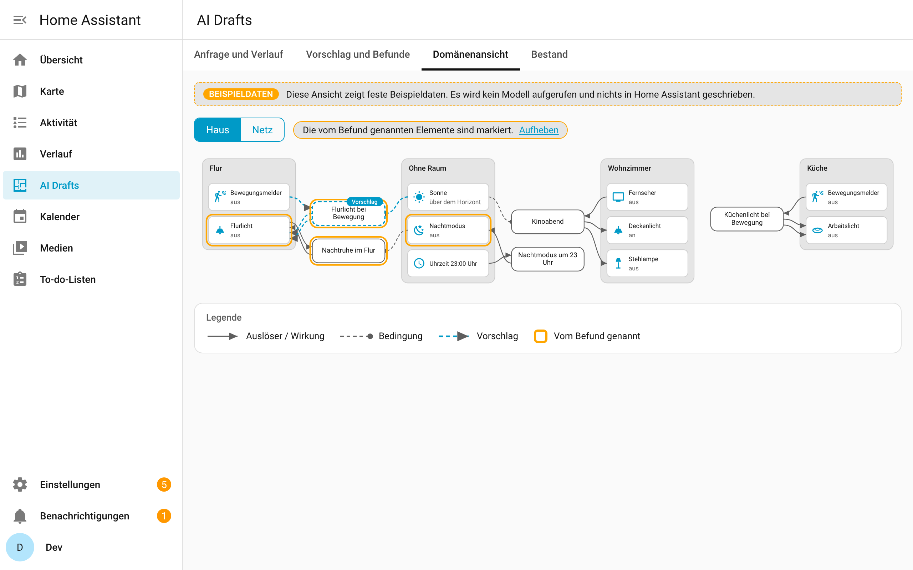
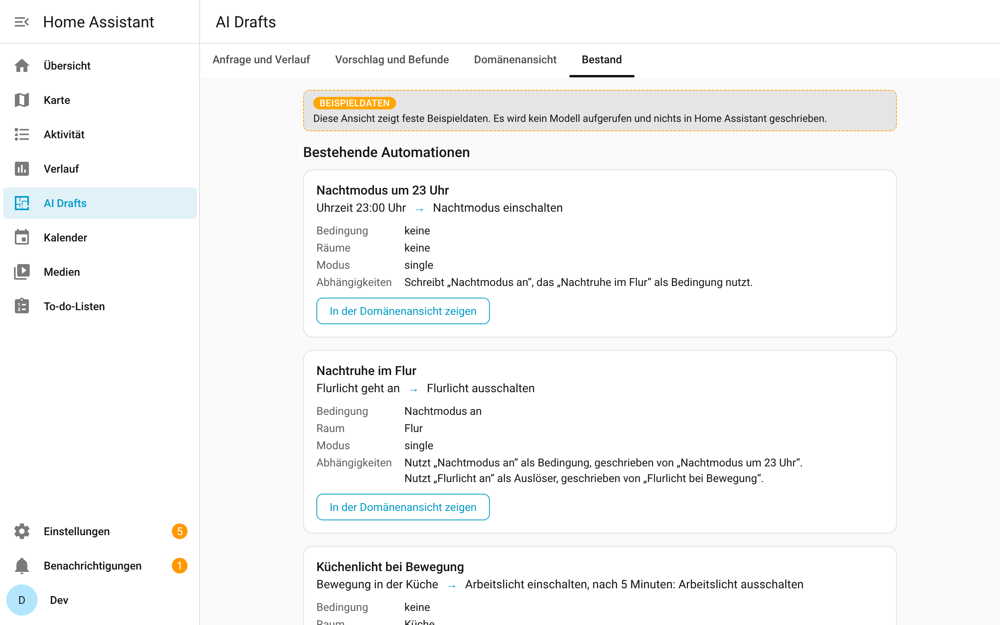
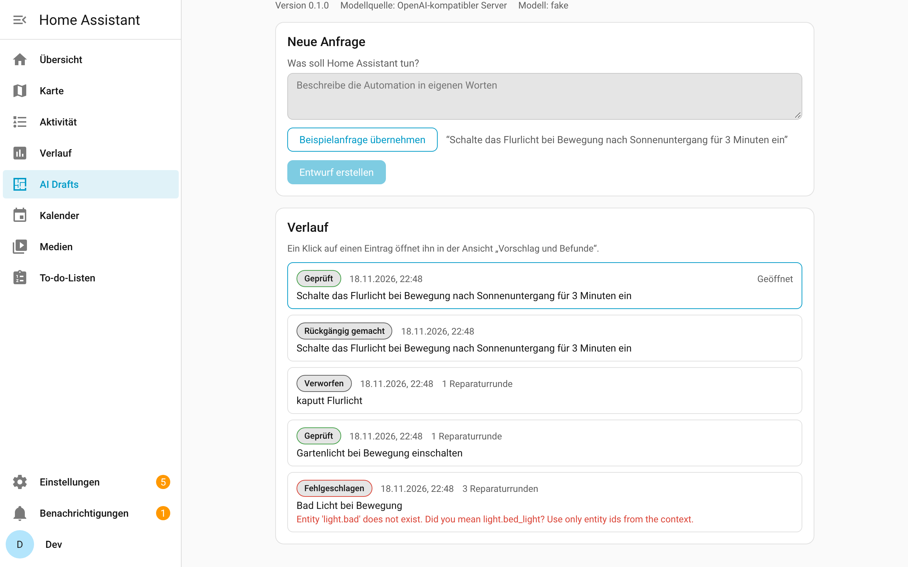
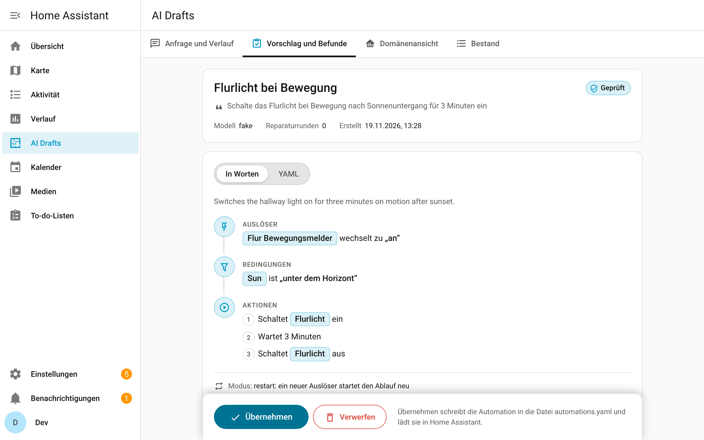

# Plan: LLM-gestütztes Entwurfswerkzeug für Home Assistant

Name: **AI Drafts** (Domain `ai_drafts`), festgelegt am 18.11.2026. Der frühere Arbeitstitel war „Blaupause“.

Stand: 18.11.2026, Fassung 2. Dieses Dokument ist der Einstieg für die Entwicklungssitzung. Es liegt im Repo als `PLAN.md` und wird dort fortgeschrieben.

Änderungen gegenüber Fassung 1: Das Netz ist gemeinsamer Kern für Prüfung und Darstellung. Die Domänenansicht ist aufgenommen. M0 enthält einen Schaukasten mit Beispieldaten. Die Meilensteine sind neu geordnet.

In diese Fassung eingearbeitet sind die Ergebnisse der ersten Sitzung: die verifizierten Schnittstellen (Abschnitt 5), Name und Lizenz (Abschnitt 10), die offenen Punkte aus der Durchsicht von Fassung 2 (Abschnitt 10) und der Stand (Abschnitt 13).

## 1. Ziel

Eine Custom Integration für Home Assistant, mit der sich Automationen und Dashboards in natürlicher Sprache erstellen und ändern lassen. Die Bedienung erfolgt in einem eigenen Panel in der HA-Seitenleiste.

Abgrenzung zu vorhandenen Lösungen (ha-mcp, AI Agent HA, Selora AI):

- Das Modell schreibt nie direkt in die Konfiguration. Es erzeugt einen Änderungsvorschlag. Eine deterministische Prüfschicht validiert ihn, der Mensch sieht eine Vorschau und entscheidet.
- Automationen werden in ein Netz überführt. Auf diesem Netz arbeiten die Konfliktanalyse und die Domänenansicht.

Abgrenzung zu Node-RED, AppDaemon und Pyscript: Das sind eigene Automationssysteme, die ihre Abläufe selbst ausführen. AI Drafts führt nichts aus. Es entstehen normale Home-Assistant-Automationen, die auch ohne AI Drafts weiterlaufen. Was diese Systeme im Haus schalten, sieht AI Drafts nur eingeschränkt (Abschnitt 4, „Externe Automationsquellen“).

## 2. Leitprinzipien

1. **Vorschlag statt Aktion.** Jede Änderung ist ein Change Set mit Status. Geschrieben wird erst nach Bestätigung.
2. **Strukturierte Ausgabe.** Das Modell liefert JSON nach Schema, kein freies YAML.
3. **Deterministisch prüfen.** Alles, was sich ohne Modell prüfen lässt, wird ohne Modell geprüft. Fehler gehen als Rückmeldung in eine begrenzte Reparaturschleife.
4. **Ein Modell des Verhaltens.** Prüfung und Darstellung arbeiten auf demselben Netz.
5. **Darstellung in Begriffen des Hauses.** Entschieden wird anhand von Räumen, Geräten, Auslösern und Wirkungen, nicht anhand von YAML.
6. **Umkehrbar.** Vor jedem Schreiben ein Schnappschuss, Rückgängig mit einem Klick.
7. **Modellunabhängig.** Lokale Modelle (Ollama) und Cloud-Modelle sind austauschbar.
8. **Nativ.** Das Panel nutzt HA-Komponenten und HA-Themes.
9. **Nachvollziehbar.** Jeder Vorschlag wird mit Prüfergebnis und Entscheidung protokolliert.

## 3. Architektur

```
Panel (Lit/TS)  <-- WebSocket -->  Integration (Python)
  |- Anfrage und Verlauf             |- context    Hausmodell und Auswahl des Ausschnitts
  |- Vorschlag und Befunde           |- drafting   Modellaufruf, strukturierte Ausgabe
  |- Domänenansicht                  |- net        Automation -> Netz, Annotationen
  |- Bestand                         |- checks     Validierung, Konfliktanalyse
                                     |- changeset  Zustandsautomat, Speicherung
                                     |- apply      Schreiben, Schnappschuss, Rückgängig
                                     |- journal    Protokoll
```

### Pipeline

| Schritt | Inhalt |
|---|---|
| Kontext | Entitäten, Geräte, Bereiche, Labels, bestehende Automationen. Zur Anfrage wird ein Ausschnitt gewählt (zunächst Schlagwort- und Bereichsfilter, später Embeddings). |
| Entwurf | Modell erhält Anfrage, Ausschnitt und Zielschema. Ergebnis ist ein Change Set. |
| Netz | Der Entwurf wird in ein Netz überführt und mit dem Netz des Bestands zusammengeführt. |
| Prüfung | Siehe Abschnitt 6. Bei Fehlern maximal 3 Reparaturrunden. |
| Vorschau | Automationen in der Domänenansicht, YAML-Diff als zweite Ansicht. Dashboards live gerendert. |
| Übernehmen | Schnappschuss, Schreiben über HA-Schnittstellen, Neuladen. |
| Rückgängig | Schnappschuss zurückspielen. |

### Change Set

```json
{
  "id": "cs_...",
  "request": "Text der Anfrage",
  "status": "draft | checked | failed | applied | reverted | discarded",
  "operations": [
    {
      "kind": "automation | script | helper | dashboard_view | dashboard_card",
      "op": "create | update | delete",
      "target_id": "...",
      "before": {},
      "after": {}
    }
  ],
  "findings": [
    {"severity": "error | warning | info", "check": "...", "message": "...", "path": "...", "net_refs": []}
  ],
  "model": "...",
  "rounds": 0,
  "created": "...",
  "decided": "..."
}
```

Zustände: `draft -> checked -> applied -> reverted`, daneben `failed` und `discarded`. Fehler der Stufe `error` blockieren das Übernehmen, Warnungen nicht. `net_refs` verweist auf Netzelemente, damit ein Befund in der Domänenansicht markiert werden kann.

## 4. Netz und Domänenansicht

### Netz als gemeinsamer Kern

Jede Automation wird in ein Workflow-Netz überführt. Die Netze aller Automationen werden über gemeinsame Entitäten verbunden. Auf diesem Gesamtnetz arbeiten Konfliktanalyse und Domänenansicht.

Die genaue Abbildung ist Entwurfsaufgabe in M2. Ausgangspunkt:

| HA-Konzept | Netz |
|---|---|
| Zustand einer Entität | Stelle |
| Auslöser | Transition, die auf eine Zustandsänderung oder ein Ereignis reagiert |
| Bedingung | Kante zu einer Zustandsstelle bzw. Wächter an der Transition |
| Aktion | Transition, die Zustände schreibt |
| Auswahl und Verzweigung (`choose`, `if`) | Alternative Transitionen |
| Wartezeit, Template, Ausführungsmodus | Annotation |

Die Abbildung ist eine Abstraktion. Templates, Wartezeiten und die Ausführungsmodi (`single`, `restart`, `queued`, `parallel`) werden nicht vollständig im Netz ausgedrückt. In M2 wird festgelegt, was das Netz ausdrückt und was als Annotation mitläuft. Jede Vereinfachung wird dokumentiert, weil sie die Aussagekraft der Konfliktanalyse begrenzt.

Jedes Netzelement behält den Verweis auf seine Herkunft (Automation, Pfad in der Konfiguration, Entität, Bereich). Dieser Verweis ist die Grundlage der Domänenansicht.

### Domänenansicht

Eingabe ist das Netz mit Herkunftsverweisen, Ausgabe eine Sicht in Begriffen des Hauses.

- Gliederung nach Bereichen (Räumen), darin Geräte und Entitäten
- Automationen als Wirkbeziehungen zwischen Auslöser und Wirkung
- Namen, Symbole und Zustände aus Home Assistant
- Umschalten auf das zugrunde liegende Netz für die fachliche Kontrolle

Drei Einsatzstellen im Panel:

1. **Vorschau eines Vorschlags.** Neue oder geänderte Automation hervorgehoben im betroffenen Ausschnitt.
2. **Bestand.** Alle Automationen im Überblick, mit Abhängigkeiten und Auslöseketten.
3. **Befunde.** Konflikte werden an den betroffenen Elementen markiert.

Dashboards haben kein Verhalten. Für sie bleibt die Live-Vorschau die Darstellung.

### Externe Automationsquellen

Flows in Node-RED und Apps in AppDaemon oder Pyscript sind keine Home-Assistant-Automationen und tauchen im Netz nicht auf. Ohne Gegenmaßnahme wäre die Konfliktanalyse dort unvollständig, ohne dass man es sieht. Ziel ist deshalb zuerst, die Lücke sichtbar zu machen, und erst danach, sie zu schließen.

Grundlage, am 18.11.2026 gegen Core 2026.10.4 geprüft: Jede Zustandsänderung trägt einen Kontext. Läuft eine Home-Assistant-Automation, hängt der Kontext am Auslöser und hat keinen Benutzer. Kommt ein Aufruf über die API oder den WebSocket, trägt der Kontext den Benutzer der Verbindung. Der Recorder speichert beides.

Drei Stufen:

1. **Beobachten.** Aus dem Verlauf wird je Entität abgeleitet, wer sie schreibt: eine Home-Assistant-Automation, ein Mensch oder eine Quelle von außen. Eine Quelle von außen wird im Netz zu einer Transition ohne Eingang, die den Zustand schreibt. Die Domänenansicht markiert die Entität, und die Konfliktanalyse meldet einen Befund: Diese Entität wird auch von außen geschaltet, Wechselwirkungen damit sind nicht geprüft. Das deckt Node-RED und AppDaemon ab, weil beide über die API schalten.
2. **Kennzeichnen.** Der Nutzer kann Entitäten über ein Label als von außen gesteuert markieren. Das ergänzt die Beobachtung, wo sie nichts gesehen hat, und korrigiert sie, wo sie irrt.
3. **Einlesen** (optional, nicht terminiert). Die Home-Assistant-Knoten eines Node-RED-Flows lassen sich statisch in das Netz übersetzen: Auslöser-Knoten, Aktions-Knoten und die Verdrahtung dazwischen. Funktionsknoten mit eigenem Code bleiben undurchsichtig und werden als solche ausgewiesen. Für AppDaemon und Pyscript ist das nicht geplant, weil dort beliebiger Code läuft.

Grenzen der Beobachtung:

- Sie zeigt nur, was im betrachteten Zeitraum tatsächlich geschaltet wurde, nicht was geschaltet werden könnte.
- Sie kennt die Wirkung, nicht den Auslöser und nicht die Bedingung. Ein Konflikt lässt sich damit vermuten, nicht belegen.
- Add-ons, die über den Supervisor zugreifen, teilen sich einen Systembenutzer. Node-RED und AppDaemon sind dann nicht voneinander zu unterscheiden, wohl aber von Automationen und Menschen.
- Pyscript läuft im Prozess von Home Assistant selbst. Ob seine Schreibzugriffe erkennbar sind, ist nicht geprüft.

## 5. Schnittstellen zu Home Assistant

**Verifiziert am 18.11.2026** gegen den Quellcode von Home Assistant Core 2026.10.4 (die Version, die `pytest-homeassistant-custom-component` 0.13.375 festschreibt) und gegen den Entwickler-Blog. Das aktuelle Release 2026.11.2 wurde nicht gesondert geprüft.

| Zweck | Schnittstelle (Stand 2026.10) | Befund |
|---|---|---|
| Panel registrieren | `panel_custom.async_register_panel(hass, frontend_url_path=, webcomponent_name=, module_url=, sidebar_title=, sidebar_icon=, require_admin=, config=)`; Entfernen mit `frontend.async_remove_panel(hass, frontend_url_path)`. Statische Dateien: `await hass.http.async_register_static_paths([StaticPathConfig(url_path, path, cache_headers)])` (`StaticPathConfig` aus `homeassistant.components.http`) | Bestätigt. `frontend.async_register_built_in_panel` ist für eingebaute Panels gedacht, wir nutzen `panel_custom`. Manifest braucht `dependencies` auf `http`, `frontend`, `panel_custom`. |
| Eigene Kommandos | `websocket_api.async_register_command(hass, handler)` mit `@websocket_api.websocket_command({...})`, `@websocket_api.require_admin`, `@websocket_api.async_response` | Bestätigt. |
| Register lesen | `entity_registry`, `device_registry`, `area_registry`, `label_registry` | Bestätigt. Zusätzlich vorhanden: `floor_registry`, `category_registry`. |
| Automation validieren | `homeassistant.components.automation.config.async_validate_config_item(hass, config_key, config)` wirft bei Fehlern `Invalid` bzw. `HomeAssistantError` und liefert sonst eine `AutomationConfig` mit `validation_status`. WebSocket `validate_config` mit den Schlüsseln `triggers`, `conditions`, `actions` liefert je Schlüssel `{valid, error}`. | Bestätigt. Das Modul ist komponentenintern (kein öffentlicher Export), Zugriff kapseln. |
| Bestehende Automationen lesen | `hass.data[automation.DATA_COMPONENT].entities`, je Entität `raw_config` sowie `referenced_entities`, `referenced_devices`, `referenced_areas`, `referenced_labels`, `referenced_floors` | Ergänzt. Deckt auch YAML-basierte Automationen ab und ist die Eingabe für die Übersetzung in das Netz. |
| Automation schreiben | REST `POST` bzw. `DELETE /api/config/automation/config/{id}` (`EditAutomationConfigView`): validiert, schreibt `automations.yaml`, ruft `automation.reload` mit `{"id": ...}` (lädt nur diese eine Automation neu); beim Löschen wird der Registry-Eintrag entfernt. | **Abweichung:** Es gibt weder eine Python-API noch ein WebSocket-Kommando. Der View serialisiert Schreibzugriffe über einen eigenen `mutation_lock`, an den eine Integration nicht herankommt. Siehe „Offen für M1“. |
| Templates prüfen | `Template(template, hass)`, dann `ensure_valid()` für die Syntax und `async_render(variables, parse_result, limited, strict, log_fn)` | Bestätigt. `hass` ist Pflichtargument. `strict=True` macht undefinierte Variablen zu Fehlern. |
| Dashboards | WebSocket `lovelace/config`, `lovelace/config/save`, `lovelace/config/delete`, `lovelace/info` (Speichern und Löschen nur für Administratoren). In Python: `hass.data[LOVELACE_DATA].dashboards[url_path]` mit `mode`, `async_load(force)`, `async_save(config)`. | Bestätigt. YAML-Dashboards haben `mode == "yaml"` und lehnen `async_save` ab. |
| Modellaufruf | Dienst `ai_task.generate_data` (`task_name`, `instructions`, `entity_id`, `structure`, `attachments`) bzw. in Python `ai_task.async_generate_data(hass, task_name=, entity_id=, instructions=, structure=)` mit Ergebnis `GenDataTaskResult.data` | **Abweichung:** `structure` ist kein JSON-Schema. Der Dienst nimmt ein Feld-Dict `{name: {selector, description, required}}`, die Python-Funktion direkt ein Schema aus Selektoren. Siehe „Offen für M1“. |

### Weitere Befunde

- **Probatio statt voluptuous.** Seit Core 2026.9 läuft die Schema-Validierung auf `probatio`. Der Core importiert `probatio` direkt, `import voluptuous as vol` wird beim Start auf Probatio umgeleitet und funktioniert unverändert weiter ([Entwickler-Blog vom 30.09.2026](https://developers.home-assistant.io/blog/2026/09/30/probatio-validation-engine)). Wir bleiben beim `voluptuous`-Import, das funktioniert auf alten und neuen Versionen.
- **Python 3.14.** Core 2026.10 und 2026.11 setzen Python 3.14 voraus. Tests und Devcontainer laufen auf 3.14.
- **Mindestversion.** `manifest.json` kennt kein Feld für eine HA-Mindestversion. Sie steht in `hacs.json` (`homeassistant`) und wird zusätzlich beim Setup zur Laufzeit geprüft. Festgelegt auf 2026.10.0, weil gegen diese Linie getestet wird.
- **Brand-Bilder.** Seit Core 2026.3 liefern Custom Integrations ihr Icon selbst aus: `custom_components/ai_drafts/brand/icon.png` ([Entwickler-Blog vom 24.02.2026](https://developers.home-assistant.io/blog/2026/02/24/brands-proxy-api)). Die HACS-Validierung prüft dieses Verzeichnis.
- **HACS-Validierung.** Die Prüfungen `description` und `topics` hängen an den GitHub-Repo-Einstellungen, nicht am Code. Beides ist im Repo noch nicht gesetzt.

### Offen für M1

- **Automationen schreiben.** Zwei Wege: (a) Das Backend schreibt `automations.yaml` selbst mit denselben Lese- und Schreibhelfern wie der View und ruft danach `automation.reload` mit der ID auf. Eigenes Lock, Restrisiko bei gleichzeitiger Bearbeitung im HA-Editor. (b) Das Backend ruft den REST-Endpunkt der eigenen Instanz auf und nutzt damit Validierung, Lock und Reload des Views. **Entschieden (18.11.2026): (a)**, weil Schnappschuss und Schreiben dann in einer Hand liegen; den Schnappschuss unmittelbar vor dem Schreiben unter dem eigenen Lock ziehen.
- **Strukturierte Ausgabe über AI Task.** Verschachtelung geht nur über den `object`-Selektor mit `fields` und `multiple`. Jede AI-Task-Entität wandelt das Schema selbst in das Format ihres Anbieters um. Die OpenAI-Integration verlangt dabei ausdrücklich definierte Felder und lehnt ein frei geformtes Objekt ab. Die Automation in `after` reist deshalb über AI Task als JSON-Text in einem Textfeld. Das besteht die Schemaprüfung der OpenAI-Integration. Ob Modelle in einem Textfeld zuverlässig gültiges JSON schreiben, ist offen und nur mit einem echten Modell zu klären. AI Task kennt außerdem keine Trennung von System- und Nutzertext und keine Temperatur. Der eigene OpenAI-kompatible Client schickt ein echtes JSON-Schema.

Bekannte Einschränkung: Automationen und Dashboards im YAML-Modus (Pakete, `!include`) können nicht über die UI-Schnittstellen geschrieben werden. Sie werden gelesen, in das Netz überführt und in Konfliktanalyse und Domänenansicht berücksichtigt.

## 6. Prüfungen

**Stufe A, Gültigkeit** (auf der Konfiguration)
- Schema der Automation bzw. der Karte
- Entitäten, Geräte, Bereiche existieren
- Aktionen (Services) existieren, Pflichtfelder gesetzt
- Templates rendern ohne Fehler
- IDs und Aliasse kollidieren nicht

**Stufe B, Plausibilität** (auf der Konfiguration)
- Zustandswerte passen zur Entität (z. B. `on`/`off`, Wertebereiche, Einheiten)
- Automation kann auslösen (Trigger nicht widersprüchlich zu Bedingungen)
- Dashboard-Karte passt zum Entitätstyp

**Stufe C, Konflikte mit dem Bestand** (auf dem Netz)
- Gegenläufige Aktionen auf derselben Entität bei überlappenden Auslösern
- Auslöseketten und Zyklen zwischen Automationen
- Dubletten zu bestehenden Automationen

## 7. Repo-Struktur

```
custom_components/ai_drafts/
  __init__.py  manifest.json  config_flow.py  const.py
  websocket.py  context.py  drafting.py  changeset.py
  apply.py  journal.py  pipeline.py  data.py
  net/  model.py  translate.py  merge.py  export.py
  checks/  validity.py  plausibility.py  conflicts.py
  schemas/  automation.json  dashboard.json
  frontend/  (gebautes Bundle)
  translations/  de.json  en.json
frontend/
  src/  views/  request  proposal  domain-view  inventory
        demo/   (Beispieldaten für den Schaukasten)
  package.json  (Lit, TypeScript, Vite oder Rollup)
tests/  conftest.py  fixtures/  test_*.py
eval/  cases/  run_eval.py
scripts/  setup  develop  lint  fake_model.py
.devcontainer/  .github/workflows/  hacs.json  PLAN.md  README.md
```

## 8. Meilensteine

### M0 Gerüst und Schaukasten
Ziel ist eine frühe, sichtbare Fassung in Home Assistant. Sie ist nicht funktionsfähig, zeigt aber alle geplanten Ansichten.

- Integration lädt, Config Flow mit Auswahl der Modellquelle
- Panel in der Seitenleiste mit den vier Ansichten: Anfrage und Verlauf, Vorschlag und Befunde, Domänenansicht, Bestand
- Alle Ansichten werden aus festen Beispieldaten gespeist (`frontend/src/demo`). Kein Modellaufruf, kein Schreiben.
- Beispielszenario: ein kleines Haus mit drei Räumen und vier Automationen, ein vorbereiteter Vorschlag mit einem Konfliktbefund, durchklickbar von der Anfrage bis zum Übernehmen
- Sichtbare Kennzeichnung als Demo
- Devcontainer mit frischer HA-Instanz, CI mit `hassfest`, HACS-Validierung, `ruff`, `pytest`, Frontend-Build

Abnahme: Installation in der Dev-Instanz, das Beispielszenario lässt sich im Panel durchklicken, CI grün.

Zweck des Schaukastens: Bedienkonzept und Domänenansicht früh beurteilen, bevor die Logik dahinter steht. Die Beispieldaten haben bereits die Form von Change Set und Netz und dienen später als Test-Fixtures.

### M1 Automationen, durchgängig
- Kontextaufbau und Ausschnittwahl
- Entwurf als Change Set über strukturierte Ausgabe
- Prüfungen der Stufe A mit Reparaturschleife
- Ansichten Anfrage und Vorschlag mit echten Daten, Vorschau als YAML-Diff
- Schnappschuss und Rückgängig, Protokoll

Abnahme: „Schalte das Flurlicht bei Bewegung nach Sonnenuntergang für 3 Minuten ein“ führt zu einer gültigen Automation. Ein Entwurf mit erfundener Entität wird erkannt und repariert oder blockiert.

### M2 Netz als Kern
- Abbildung Automation -> Netz festlegen und dokumentieren (Abschnitt 4)
- Übersetzung für UI- und YAML-basierte Automationen, Zusammenführung zum Gesamtnetz
- Herkunftsverweise an allen Netzelementen
- Export des Netzes (PNML oder JSON) für die Kontrolle in externen Werkzeugen
- Transitionen ohne Eingang für Schreibzugriffe von außen im Netz vorsehen (Abschnitt 4, „Externe Automationsquellen“)

Abnahme: Die Automationen der Dev-Instanz und eines anonymisierten Abzugs einer echten Instanz werden ohne Fehler übersetzt. Nicht abbildbare Konstrukte werden als Annotation ausgewiesen.

### M3 Domänenansicht
- Ansicht Bestand mit echten Daten
- Vorschau eines Vorschlags in der Domänenansicht, YAML-Diff als zweite Ansicht
- Umschalten auf das Netz

### M4 Konfliktanalyse
- Prüfungen der Stufe C auf dem Gesamtnetz
- Markierung der Befunde in der Domänenansicht
- Schreibzugriffe von außen beobachten und kennzeichnen, als Befund melden und in der Domänenansicht markieren

### M5 Bearbeiten und Erklären
- Bestehende Automationen ändern
- Automation in Klartext erklären
- Prüfungen der Stufe B
- Skripte und Helfer als weitere Operationstypen

### M6 Dashboards
- Ansichten und Karten erzeugen und ändern
- Live-Vorschau im Panel
- Beschränkung auf Kernkarten, optionale Erkennung installierter Custom Cards

### M7 Härtung für lokale Modelle
- Eval-Lauf mit Ollama, Auswertung nach Modell
- Anpassung von Prompt, Ausschnittgröße und Schema
- HACS-Release

## 9. Tests und Evaluation

- **Unit-Tests** für Prüfungen, Zustandsautomat und Übersetzung mit `pytest-homeassistant-custom-component`. Das Modell wird durch feste Antworten ersetzt.
- **Übersetzungstests:** Paare aus Automation und erwartetem Netz, je Konstrukt mindestens ein Fall.
- **Eval-Satz** in `eval/cases`: Anfrage, Ausgangskonfiguration, erwartete Eigenschaften des Ergebnisses. Start mit 30 Fällen, darunter Fälle mit absichtlich fehlender Entität und mit Konflikt.
- **Kennzahlen:** Anteil gültiger Entwürfe im ersten Versuch, nach Reparatur, Zahl der Runden, Laufzeit, erkannte Konflikte.
- **Protokoll:** Je Vorschlag wird festgehalten, in welcher Ansicht entschieden wurde. Damit lässt sich später vergleichen, ob Vorschläge in der Domänenansicht anders beurteilt werden als im YAML-Diff.

## 10. Offene Entscheidungen

| Frage | Vorschlag |
|---|---|
| Name und Domain | **Entschieden (18.11.2026): AI Drafts, Domain `ai_drafts`.** |
| Modell für die Entwicklung | Claude bis M6, Ollama als Härtetest in M7 |
| Modellanbindung | AI Task, falls strukturierte Ausgabe dort ausreicht, sonst eigener Client |
| Abstraktionsgrad des Netzes | in M2 festlegen, zunächst einfache Stellen-Transitions-Netze mit Annotationen |
| Darstellung der Domänenansicht | SVG mit Lit. **Entschieden (18.11.2026) für den Schaukasten:** eigenes einfaches Layout ohne Bibliothek. `elkjs` wird erst in M3 mit echten Daten geprüft. |
| Netzformat für den Export | JSON intern, PNML als Export |
| Lizenz | **Entschieden (18.11.2026): MIT.** |
| Sprache | Oberfläche Deutsch und Englisch, Code und Doku Englisch |
| YAML-basierte Konfiguration schreiben | nicht geplant, nur lesen |

### Offene Punkte aus der Durchsicht von Fassung 2

Diese Punkte sind bei der Durchsicht am 18.11.2026 aufgefallen. Wo nichts anderes steht, sind die Vorschläge noch nicht entschieden. Für die drei Punkte, von denen der Schaukasten abhängt, gilt die schlanke Variante.

| Punkt | Worum es geht | Vorschlag |
|---|---|---|
| Netzformat vor M2 | Die Beispieldaten aus M0 sollen schon die Form des Netzes haben und später als Fixtures dienen. Die Abbildung wird aber erst in M2 festgelegt. | **Entschieden (18.11.2026):** In M0 ein vorläufiges JSON-Format mit Versionsfeld (Stellen, Transitionen, Kanten, Annotationen, Herkunft, stabile IDs), so klein wie möglich. Die Fixtures werden in M2 voraussichtlich neu erzeugt. |
| Stelle je Entität oder je Zustand | „Zustand einer Entität -> Stelle“ lässt offen, ob eine Entität eine Stelle bekommt oder jeder ihrer Zustände. Numerische Zustände lassen sich nicht aufzählen. Davon hängt ab, was Stufe C zeigen kann, und schon die Beispieldaten müssen sich festlegen. | **Entschieden (18.11.2026) für M0:** eine Stelle je diskretem Zustand (`on`, `off`), und nur für Zustände, die in einer Automation vorkommen. Alles andere als Wächter-Annotation. In M2 überprüfen. |
| Netzklasse | Abschnitt 4 spricht von Workflow-Netzen, die Tabelle oben von Stellen-Transitions-Netzen. Das über Entitäten verbundene Gesamtnetz hat keine einzelne Quelle und Senke und ist damit kein Workflow-Netz. | Je Ebene benennen: Ablauf einer einzelnen Automation, Gesamtnetz über die Zustandsstellen. |
| Lücken der Abbildung | Die Tabelle in Abschnitt 4 deckt drei Dinge nicht ab: Umwege über Skripte und Szenen, Ziele über Bereich, Label oder Gerät, die erst zur Laufzeit aufgelöst werden, und abgeleitete Zustände (Gruppen, Template-Entitäten). Auslöseketten, die darüber laufen, bleiben sonst unsichtbar. Die Flur-Entitäten der Dev-Instanz sind selbst Template-Entitäten. | In M2 als eigene Fälle in die Abbildung und in die Übersetzungstests aufnehmen. |
| Leitprinzip 4 | „Prüfung und Darstellung arbeiten auf demselben Netz“ gilt für Stufe C und die Domänenansicht. Stufe A und B arbeiten laut Abschnitt 6 auf der Konfiguration, und in M1 gibt es noch kein Netz. | Formulierung an Abschnitt 1 angleichen: Konfliktanalyse und Domänenansicht. |
| Ablage der Beispieldaten | Sie liegen laut Plan in `frontend/src/demo`, sollen aber auch Python-Tests dienen. | **Umgesetzt:** JSON-Dateien in `frontend/src/demo`, die das Frontend beim Bau einbindet und `pytest` direkt liest. Ein Test schickt alle Beispiel-Change-Sets durch `ChangeSet.from_dict`. |
| Schweregrad im Beispiel | Der Beispielvorschlag soll trotz Konfliktbefund bis zum Übernehmen durchklickbar sein. Ein Befund der Stufe `error` sperrt das Übernehmen. | **Umgesetzt:** Der Konfliktbefund im Beispiel ist eine `warning`. |
| Demo-Kennzeichnung | Zwischen M1 und M3 zeigen zwei Ansichten echte Daten und zwei Beispieldaten. | **Umgesetzt:** Jede Ansicht trägt ihren eigenen Hinweis. |
| Größe von `elkjs` | `elkjs` 0.12.1 misst 1,65 MB minifiziert und 480 kB gzip-komprimiert. Das heutige Bundle hat 24 kB. Das Bundle ist eingecheckt. | **Entschieden (18.11.2026):** kein `elkjs` im Schaukasten. Das Bundle bleibt klein, eine Datei und eingecheckt. Erneut prüfen in M3, wenn echte Installationen dargestellt werden. |
| Abzug einer echten Instanz | Die Abnahme von M2 braucht einen anonymisierten Abzug. Das Repo ist öffentlich. | Abzug nicht ins Repo legen, solange kein Anonymisierungsskript existiert und geprüft ist. Ablageort festlegen. |
| „In welcher Ansicht entschieden“ | Wer beide Ansichten öffnet, hat nicht in einer entschieden. Ohne Zuteilung wählen Nutzer die Ansicht selbst, was den Vergleich verzerrt. | Festhalten, welche Ansichten geöffnet waren und welche bei der Entscheidung aktiv war. Für einen belastbaren Vergleich die Startansicht zuteilen. |
| Abnahmekriterien | M0 bis M2 haben eine Abnahme, M3 bis M7 nicht. | Für M3 und M4 ergänzen, weil dort die beiden Unterscheidungsmerkmale liegen. |
| Abgrenzung | Laut ihren eigenen Beschreibungen arbeiten Helmsman und AI Agent HA ebenfalls mit Freigabe vor dem Schreiben, Helmsman zusätzlich mit Diff und Schnappschüssen. Das ist nicht in den Repos nachgeprüft. | Prüfen und Abschnitt 1 anpassen. Das Netz als zweites Merkmal bleibt davon unberührt. |

## 11. Risiken

- **HA-interne Schnittstellen ändern sich.** Zugriffe kapseln, Mindestversion in `manifest.json` und `hacs.json` festhalten.
- **Abbildung auf Netze ist unvollständig.** Vereinfachungen dokumentieren, Befunde der Stufe C als Warnung und nicht als Fehler einstufen, solange die Abbildung nicht belastbar ist.
- **Automationen außerhalb von Home Assistant.** Node-RED, AppDaemon und Pyscript schalten Entitäten, ohne im Netz aufzutauchen. Die Lücke wird sichtbar gemacht, statt Vollständigkeit vorzutäuschen (Abschnitt 4, „Externe Automationsquellen“).
- **Domänenansicht skaliert nicht.** Große Installationen früh testen, Ausschnitt nach Bereich und Filter anbieten.
- **Kontextgröße bei großen Installationen.** Ausschnittwahl früh testen, Obergrenzen einbauen.
- **Schreibrechte.** Panel und Kommandos nur für Administratoren. Kein Schreiben ohne Bestätigung, auch nicht über Dienste.
- **Datenabfluss an Cloud-Modelle.** Im Config Flow sichtbar machen, welche Daten an welches Modell gehen.

## 12. Auftrag für die erste Sitzung

1. `PLAN.md` lesen. Abschnitt 5 gegen die aktuelle HA-Entwicklerdokumentation prüfen und Abweichungen hier eintragen. **Erledigt.**
2. M0 umsetzen: Gerüst, Devcontainer, CI, Panel mit den vier Ansichten und dem Beispielszenario. **Erledigt.** Der Devcontainer ist gebaut, aber nicht geprüft (Abschnitt 13).
3. Beispieldaten in der Form von Change Set und Netz anlegen, sodass sie später als Fixtures dienen. **Erledigt**, im vorläufigen Netzformat Version 0.
4. Am Ende Stand, Bildschirmfotos der vier Ansichten und nächste Schritte in `PLAN.md` nachtragen. **Erledigt** (Abschnitt 13).

## 13. Stand nach Sitzung 1 (18.11.2026)

M0 ist umgesetzt. Offen ist allein die Prüfung des Devcontainers, die in der Sitzungsumgebung nicht möglich war.

### Erledigt

- **Abschnitt 5** gegen Core 2026.10.4 geprüft, Abweichungen dort eingetragen.
- **Gerüst:**
  - Die Integration lädt über einen Config Entry.
  - Der Config Flow bietet ein Menü mit „AI Task“ und „OpenAI-kompatibler Server“. Beide Schritte sagen vor der Entscheidung, welche Daten an das Modell gehen.
  - Das Panel steht nur für Administratoren in der Seitenleiste.
  - WebSocket-Kommandos `ai_drafts/info` und `ai_drafts/changesets/list`, beide nur für Administratoren. Der API-Schlüssel wird nie zurückgegeben.
  - Dev-Instanz (`config/configuration.yaml`) mit Demo-Integration und Template-Entitäten für das Flur-Szenario: `binary_sensor.flur_bewegungsmelder` und `light.flurlicht`, gesteuert über zwei `input_boolean`.
  - Devcontainer, Skripte (`scripts/setup`, `develop`, `lint`), CI.
- **Change Set** (`changeset.py`): Datenmodell nach Abschnitt 3 einschließlich `net_refs`, Zustandsautomat, Speicherung über den HA-Store.
- **Schaukasten:**
  - Vier Ansichten im Panel: Anfrage und Verlauf, Vorschlag und Befunde, Domänenansicht, Bestand. Jede trägt den Hinweis, dass sie Beispieldaten zeigt und nichts geschrieben wird.
  - Beispieldaten in `frontend/src/demo`: ein Haus mit Flur, Wohnzimmer und Küche, vier Automationen im echten HA-Format, ein vorbereiteter Vorschlag mit einer Konfliktwarnung, drei ältere Change Sets für den Verlauf, dazu das Netz des Bestands und das Netzfragment des Vorschlags.
  - Der Vorschlag ist die Anfrage aus der M1-Abnahme. Er kollidiert mit der bestehenden „Nachtruhe im Flur“, die das Flurlicht nach 23 Uhr sofort wieder ausschaltet.
  - Die Domänenansicht und die Abhängigkeiten im Bestand werden aus dem Netz und seinen Herkunftsverweisen abgeleitet, nicht aus den Automationen. Nur die Namen der Automationen kommen aus deren Konfiguration, weil das Netz sie nicht trägt.
  - Die Domänenansicht lässt sich auf das Netz umschalten: ein Diagramm je Automation, gemeinsame Zustandsstellen stehen in jedem Diagramm, das sie nutzt.
  - Übernehmen, Verwerfen und Rückgängig ändern den Status nur im Browser und folgen dabei derselben Übergangstabelle wie `changeset.py`.
  - Die Adresse des Bundles hängt jetzt an einem Hash seines Inhalts. Ein neu gebautes Bundle wird damit nach dem Neuladen der Integration ausgeliefert.
- **Tests:** 152. Darunter laufen alle Beispiel-Change-Sets durch das echte Modell, das Netz wird auf Stimmigkeit geprüft (eindeutige IDs, Kanten nur zwischen Stelle und Transition, alle `net_refs` und Herkunftsverweise lösen auf), und die fünf Automationen bestehen die Validierung von Home Assistant.

### Bildschirmfotos

Deutsche Oberfläche, helles Theme, aufgenommen in einer laufenden Instanz von Core 2026.10.4.

**Anfrage und Verlauf**



**Vorschlag und Befunde**



**Domänenansicht**, mit den Elementen, die der Befund nennt



**Bestand**, aufgenommen nach dem Übernehmen des Vorschlags



### Abnahme M0

| Kriterium | Ergebnis |
|---|---|
| Installation in der Dev-Instanz | Geprüft. Core 2026.10.4 lokal gestartet, Config Entry über die Config-Flow-API angelegt, Zustand `loaded`. Ein Erststart in frischer Umgebung richtete Demo- und Template-Entitäten ohne Neustart ein; das wurde vor der Umbenennung auf AI Drafts geprüft und danach nicht wiederholt. |
| Beispielszenario lässt sich durchklicken | Geprüft in Chromium gegen eine laufende Instanz, zweimal unabhängig: Anfrage, Entwurf, Vorschlag mit Befund, Markierung in der Domänenansicht, Netz, Übernehmen, neuer Eintrag im Bestand, Rückgängig, Eintrag wieder weg. Keine Fehler in der Browser-Konsole. Bei 400 px Breite läuft die Seite nicht über; die Grafik scrollt in ihrer Ansicht. |
| CI grün | Geprüft. Der Lauf zum Commit mit dem Schaukasten ist grün: `hassfest`, HACS, `ruff`, `pytest` und der Frontend-Build. Bei HACS sind die Prüfungen `description` und `topics` ausgenommen. |
| Devcontainer | **Nicht geprüft.** Er lässt sich in der Sitzungsumgebung nicht starten. Geprüft ist nur, dass das Image `mcr.microsoft.com/devcontainers/python:3.14` existiert und dass `scripts/setup` und `scripts/develop` außerhalb des Containers funktionieren. |

### Festlegungen dieser Sitzung

- **Name und Bezeichner.** Name „AI Drafts“, Domain `ai_drafts`, Panel unter `/ai-drafts`, Speicher in `.storage/ai_drafts.changesets`. Frontend-Bezeichner tragen Bindestriche (`ai-drafts-panel`), alles im Backend Unterstriche.
- **Zustandsautomat.** Die Übergänge stehen als Tabelle `ALLOWED_TRANSITIONS` im Code:

  | Von | Nach |
  |---|---|
  | `draft` | `checked`, `failed`, `discarded` |
  | `checked` | `applied`, `discarded` |
  | `failed` | `discarded` |
  | `applied` | `reverted` |

  - Ein Entwurf mit `error`-Befund bleibt nach der Prüfung `draft` und wartet auf die Reparatur (`revise`). Erst ohne Fehler wird er `checked`.
  - `revise` zählt die Runde und verweigert die vierte (`MAX_REPAIR_ROUNDS = 3`). Die Pipeline ruft dann `fail` auf.
  - `apply` prüft zusätzlich selbst auf `error`-Befunde, unabhängig vom Status.
  - `decided` wird bei `apply` und `discard` gesetzt und bleibt bei `revert` unverändert.
- **Operationen.** `create` braucht `after` und hat kein `before`. `update` braucht `target_id` und `after`. `delete` braucht `target_id` und hat kein `after`. „Kein“ heißt `null`, nicht `{}`.
- **`net_refs`.** Eine Liste von IDs der Netzelemente. Gespeicherte Befunde ohne das Feld werden als leere Liste gelesen.
- **Netzformat Version 0** (vorläufig, beschrieben in `frontend/src/demo/README.md`):
  - Eine Zustandsstelle je Entität und diskretem Zustand, nur für Zustände, die eine Automation verwendet. ID `p:<entity_id>:<zustand>`.
  - Je Automation eine Kontrollstelle `p:<automation>:triggered` und eine weitere vor jedem späteren Aktionsschritt.
  - Jeder Auslöser ist eine Transition. Ein Zustandsauslöser liest seine Zustandsstelle. Ein Auslöser ohne Entitätszustand, etwa eine Uhrzeit, hat keine Eingangsstelle und trägt eine `event`-Annotation.
  - Bedingungen auf diskrete Zustände sind Lesekanten in die Auslöser-Transitionen.
  - Jeder Aktionsschritt, der einen Zustand schreibt, ist eine Transition. Sie verbraucht die andere Zustandsstelle der Entität und erzeugt die Zielstelle.
  - Wartezeit und Ausführungsmodus sind Annotationen.
  - Jedes Element trägt seine Herkunft: Automation, Pfad in der Konfiguration, Entität, Bereich.
- **Frontend-Bundle** ist eingecheckt, damit eine Installation aus dem Repo ohne Build funktioniert. CI baut neu und schlägt fehl, wenn das eingecheckte Bundle abweicht. Es misst mit dem Schaukasten 106 kB, gzip-komprimiert 26 kB, und hat außer Lit keine Abhängigkeit.
- **Keine Platzhalter-Module.** `context.py`, `drafting.py`, `apply.py`, `journal.py`, `net/`, `checks/`, `schemas/` und `eval/` entstehen erst mit Inhalt.
- **Dev-Instanz** mit expliziter Komponentenliste statt `default_config`. `ai_task` lässt sich nicht per YAML laden; eine AI-Task-Entität gibt es erst, wenn in der Instanz eine KI-Integration eingerichtet ist.

### Bekannte Punkte

Zum Schaukasten:

- **Dichte Pfeile.** In der Domänenansicht liegen am Flurlicht mehrere Pfeilspitzen eng beieinander, weil „Nachtruhe im Flur“ dieselbe Entität als Auslöser und als Wirkung hat. Lesbar, aber unruhig.
- **Lange Kanten.** Eine Bedingung aus einem entfernten Raum würde quer hinter anderen Räumen verlaufen. Im Beispiel kommt das nicht vor. Im Netz laufen Rückkanten als lange Bögen durch das Diagramm.
- **Kleine Schrift am Telefon.** Die Grafik wird bis auf etwa 70 % verkleinert und scrollt dann waagrecht. Die Schrift ist dann rund 9 bis 10 px groß.
- **Layout ist eine Heuristik.** Die Spalte „Ohne Raum“ steht in der Mitte, damit Zustände, die mehrere Räume lesen, nah liegen. Für echte Installationen ist das nicht erprobt.
- **Uhrzeit als Kachel.** Der Zeitauslöser erscheint als eigene Kachel „Uhrzeit 23:00 Uhr“ unter „Ohne Raum“, obwohl er keine Entität ist.
- **Beispieltexte nur deutsch.** Die Oberfläche ist zweisprachig, die Beispieldaten sind es nicht.
- **Zustandsautomat doppelt.** Die Übergangstabelle steht für den Schaukasten zusätzlich in `frontend/src/logic/changeset-machine.ts`. Mit M1 übernimmt das Backend, die Kopie entfällt.
- **YAML nur zur Anzeige.** Die Ausgabe stammt aus einer eigenen kleinen Funktion, nicht aus einer YAML-Bibliothek.

Zur Abbildung auf das Netz, als Eingabe für M2:

- **Hängende Marke.** „Einschalten“ verbraucht die Stelle „aus“. Ist das Licht schon an, kann die Transition nicht schalten, und die Kontrollmarke bleibt liegen.
- **Bedingung auf der Entität des Auslösers.** Sie ist im Netz nicht vom Auslöser zu unterscheiden, weil beides Lesekanten in dieselbe Transition sind.
- **Wartezeit.** Sie hängt als Annotation an der folgenden Aktion. Die Nummern der Kontrollstellen überspringen deshalb den Warteschritt.
- **Nicht ausdrückbar.** Numerische Zustände, Templates und die Wirkung der Ausführungsmodi.

Sonstiges:

- **HACS:** Die Prüfungen `description` und `topics` sind im Workflow ausgenommen, weil beides in den GitHub-Einstellungen des Repos fehlt. Vor dem HACS-Release setzen und die Ausnahme entfernen. Der HACS-Job läuft nur bei öffentlichem Repo, weil die Action private Repos ablehnt.
- **Icon:** `brand/icon.png` ist ein Platzhalter.
- **`libturbojpeg`:** Die Dev-Instanz protokolliert beim Start einen Fehler mit Traceback, weil die Systembibliothek fehlt. Betroffen sind nur Kamera-Schnappschüsse der Demo. Im Devcontainer ließe sich `libturbojpeg0` nachinstallieren.
- **Speicher:** Change Sets werden unbegrenzt aufbewahrt. Die Aufbewahrung ist mit dem Protokoll (`journal`) zu klären.

### Nächste Schritte

Vor M1:

1. Den Schaukasten beurteilen: Bedienkonzept, Domänenansicht, Netzansicht. Dafür ist er gebaut.
2. Den Devcontainer einmal öffnen.
3. Die noch offenen Punkte in Abschnitt 10 entscheiden.

M1 läuft. Der Stand steht in Abschnitt 14.

## 14. Stand M1

M1 ist in drei Teile geschnitten. Teil 1 und 2 sind fertig. Teil 3 steht aus und braucht ein echtes Modell. Bis dahin ist die Abnahme von M1 nur zur Hälfte erfüllt: Der Fall mit erfundener Entität ist gezeigt, die gültige Automation aus einem echten Modell nicht.

| Teil | Inhalt | Stand |
|---|---|---|
| 1 | Backend: Kontext, Entwurf mit Reparaturschleife, Prüfungen der Stufe A, Schreiben mit Schnappschuss und Rückgängig, Protokoll, WebSocket-Kommandos | Erledigt |
| 2 | Frontend: Ansichten Anfrage und Vorschlag auf echten Daten, YAML-Diff | Erledigt |
| 3 | Erprobung mit einem echten Modell, Entscheidung zwischen AI Task und eigenem Client, Beginn des Eval-Satzes | Offen, braucht Zugang zu einem Modell |

### Teil 1: was es gibt

- **`context.py`** wählt zur Anfrage einen Ausschnitt des Hauses. Wörter der Anfrage werden gegen Namen, Entity-IDs, Bereiche und Gerätenamen geprüft, auch als Teil zusammengesetzter Wörter („Flurlicht“ findet den Bereich „Flur“). Obergrenzen: 150 Entitäten, 30 Automationen. Deaktivierte und versteckte Entitäten bleiben draußen. Genau dieser Ausschnitt verlässt die Installation.
- **`drafting.py`** baut die Prompts und ruft das Modell über einen von zwei Wegen: AI Task oder OpenAI-kompatibler Server.
- **`checks/validity.py`** prüft Stufe A: Schema über die Validierung von Home Assistant, Existenz von Entitäten, Geräten, Bereichen und Aktionen, Pflichtfelder der Aktionen, Syntax der Templates, Kollision von IDs und Aliassen.
- **`pipeline.py`** führt Kontext, Entwurf und Prüfung zusammen und schickt Fehler für höchstens drei Runden an das Modell zurück. Es läuft immer nur ein Entwurf zugleich.
- **`apply.py`** schreibt `automations.yaml` und lädt die eine Automation neu. Vorher werden die Prüfungen wiederholt und ein Schnappschuss abgelegt. Kommt die Automation nicht hoch, wird die Datei wiederhergestellt.
- **`journal.py`** hält je Change Set fest: Anlage, jede Entwurfsrunde mit Modell, Dauer und Kontextgröße, jedes Prüfergebnis, Fehlschlag, Übernehmen, Verwerfen, Rückgängig. Bei Übernehmen und Verwerfen auch, in welcher Ansicht entschieden wurde.
- **`scripts/fake_model.py`** ist ein Stellvertreter für ein Modell mit festen Antworten, damit sich der ganze Ablauf ohne Modell durchspielen lässt.

WebSocket-Kommandos, alle nur für Administratoren. Dienste gibt es keine; geschrieben wird ausschließlich über `ai_drafts/changesets/apply`.

| Kommando | Zweck |
|---|---|
| `ai_drafts/draft` mit `request`, wahlweise `model` | Entwurf erzeugen und prüfen, auf Wunsch mit einem anderen Modell als dem eingerichteten |
| `ai_drafts/models` | Modelle der eingerichteten Quelle und der Standard |
| `ai_drafts/changesets/list`, `ai_drafts/changesets/get` mit `change_set_id` | Change Sets lesen |
| `ai_drafts/changesets/apply`, `discard`, `revert` mit `change_set_id` | Entscheiden; `apply` und `discard` nehmen zusätzlich `decided_in` und `views_opened` |
| `ai_drafts/journal/list`, wahlweise mit `change_set_id` | Protokoll lesen |
| `ai_drafts/info` | Version und Modellquelle |

Fehlercodes: `not_loaded`, `not_found`, `wrong_state`, `apply_blocked`, `apply_failed`, `revert_refused`, `busy`, `model_error`, `invalid_model`.

### Teil 1: Festlegungen

- **Umfang.** M1 legt nur neue Automationen an. Jede andere Art und jede andere Operation weisen die Prüfungen als Fehler ab.
- **Schreibweg.** Das Backend schreibt `automations.yaml` selbst, mit denselben Bausteinen und derselben Reihenfolge der Schlüssel wie der Editor von Home Assistant.
- **ID der Automation.** Nennt das Modell eine ID, wird sie verwendet, sonst wird beim Übernehmen eine erzeugt. Sie steht danach als `target_id` in der Operation.
- **Rückgängig nur unverändert.** Wurde die Automation nach dem Übernehmen von Hand bearbeitet, wird das Rückgängig verweigert und nichts geändert. Wurde sie schon gelöscht, gilt das Change Set als zurückgenommen.
- **Dateien mit `!secret` oder `!include` werden nicht angefasst.** Beim Laden werden solche Verweise aufgelöst, beim Schreiben stünde ihr Wert im Klartext in der Datei.
- **Fehlerhafte Modellausgabe** zählt wie ein Prüffehler und geht in die Reparaturschleife. Ist das Modell nicht erreichbar, endet das Change Set sofort als `failed`.
- **Ein Absturz einer Prüfung** zählt als Fehler, nie als bestanden.

### Teil 1: geprüft

- **Tests:** 335. Übernehmen und Rückgängig laufen gegen eine echte `automations.yaml` in einem temporären Konfigurationsverzeichnis mit echtem `automation.reload`, nicht gegen Attrappen.
- **Echte Instanz mit dem Stellvertreter-Modell,** zweimal unabhängig durchgespielt:
  - Die Flurlicht-Anfrage endet als `checked`. Übernehmen schreibt die Automation in die Datei, die Entität existiert. Rückgängig entfernt Eintrag und Entität.
  - Ein Entwurf mit erfundener Entität wird in einer Runde repariert.
  - Ein Entwurf, der die erfundene Entität behält, endet nach drei Runden als `failed` und lässt sich nicht übernehmen.
  - Nicht parsbare Ausgabe wird in einer Runde repariert.
- **Nicht geprüft:** jedes echte Modell, und damit der erste Teil der Abnahme von M1. Ebenso der AI-Task-Weg gegen eine echte Entität.

### Teil 1: bekannte Schwächen

Am Schreibweg:

- **Kommentare gehen verloren.** Die Datei wird beim Schreiben neu erzeugt. Der Editor von Home Assistant verhält sich genauso.
- **Kein gemeinsames Lock mit dem Editor.** Speichert jemand im Editor genau zwischen unserem Lesen und Schreiben, geht diese Änderung verloren. Das Fenster ist sehr kurz, aber nicht null.
- **„Automation läuft“ heißt nur:** Die Entität existiert und ist nicht `unavailable`. Ob der Auslöser feuert, wird nicht geprüft.
- **Konfigurationen mit Paketen** sind nicht erprobt.

An den Prüfungen:

- Entity-IDs innerhalb von Templates werden nicht geprüft. Eine fehlende Entität ergibt dort nur `unknown`.
- Labels und Etagen als Ziel werden nicht geprüft.
- Aktionsdaten, die ein Template enthalten, werden nicht gegen das Schema der Aktion geprüft.
- Ob eine Aktion zur Art der Entität passt, wird nicht geprüft. Das gehört zu Stufe B.
- Templates mit Laufzeitvariablen (`trigger`, `this`, `repeat`, `wait`) werden nur auf Syntax geprüft, nicht gerendert.

An der Auswahl des Ausschnitts:

- Der Abgleich läuft über Wortteile. Kurze Wörter wie „Bad“ können unpassende Entitäten mitziehen.

### Teil 2: was es gibt

- **Anfrage und Verlauf** fordert den Entwurf beim Backend an und zeigt die gespeicherten Change Sets, neueste zuerst. Während ein Entwurf läuft, ist der Knopf gesperrt, und ein Hinweis sagt, dass es bis zu einer Minute dauern kann. Ein Klick auf einen Eintrag öffnet ihn.
- **Vorschlag und Befunde** zeigt ein Change Set so, wie das Backend es liefert, und entscheidet über die WebSocket-Kommandos. Der Browser setzt keinen Status mehr selbst. Angeboten wird nur, was der Status erlaubt.
- **Beschreibung in Worten.** Auslöser, Bedingungen und Aktionen der Automation, mit den Namen aus Home Assistant. Sie wird aus der Konfiguration abgeleitet, weil es für echte Daten vor M2 kein Netz gibt. Was die Beschreibung nicht erkennt, erscheint als beschriftetes YAML und wird nicht geraten.
- **YAML.** Die Automation mit jeder Zeile als Zugang markiert, weil M1 nur anlegt. Ein allgemeiner Diff folgt mit dem Ändern in M5.
- **Nach dem Übernehmen** stehen die ID der Automation und ein Link in den Editor von Home Assistant.
- **Protokoll.** Übernehmen und Verwerfen melden, ob gerade die Beschreibung oder das YAML offen war und welche Ansichten besucht wurden.
- **Domänenansicht und Bestand** bleiben bei den Beispieldaten und sagen das. Die Kopie des Zustandsautomaten im Browser ist entfernt.





### Teil 2: geprüft

In Chromium gegen eine laufende Instanz mit dem Stellvertreter-Modell, zweimal unabhängig durchgeklickt:

- Flurlicht-Anfrage: Vorschlag „Geprüft“ mit Beschreibung und YAML. Übernehmen schreibt die Automation in die Datei, die Entität existiert, der Link in den Editor erscheint. Rückgängig entfernt beides.
- Anfrage mit erfundener Entität, die das Modell nicht korrigiert: „Fehlgeschlagen“, die Fehler stehen da, Übernehmen wird nicht angeboten, Verwerfen schon.
- Der Verlauf zeigt die Einträge mit ihrem Status.
- Bei abgeschaltetem Modell erscheint die Fehlermeldung, und der Verlauf bekommt einen fehlgeschlagenen Eintrag.
- Keine Fehler in der Browser-Konsole, keine Einträge von `ai_drafts` im Log.

Nicht geprüft: die englische Oberfläche, der Weg über AI Task, ein langer Entwurf mit einem echten Modell, zwei Browser-Fenster gleichzeitig.

### Teil 2: bekannte Schwächen

- **Befunde sprechen das Modell an.** Die Meldungen der Prüfungen gehen wörtlich an das Modell und in die Oberfläche. Sätze wie „Use only entity ids from the context“ sind für Menschen unpassend, und die Meldungen sind nur englisch.
- **Beschreibung ist eine Heuristik.** Schon ein unbekannter Schlüssel lässt einen Schritt als YAML erscheinen.
- **YAML zur Anzeige.** Es stammt aus der eigenen kleinen Funktion und kann in der Schreibweise von der Datei abweichen, etwa bei Anführungszeichen.
- **Modellfehler ohne Verweis.** Die Fehlermeldung nennt das fehlgeschlagene Change Set nur im Text. Es erscheint im Verlauf, ist aus der Meldung aber nicht anklickbar.
- **Neuladen beim allerersten Besuch.** In einem frischen Browser lädt Home Assistant die Seite wenige Sekunden nach dem ersten Öffnen einmal neu. Eine bis dahin getippte Anfrage ist dann weg. Ein laufender Entwurf geht nicht verloren, er steht danach im Verlauf.

### Einrichtung, nach dem ersten Versuch mit einem echten Server

Der erste Versuch mit einem echten Modellserver scheiterte an der Basis-URL. Sie zeigte auf eine Adresse, die keine OpenAI-kompatible Schnittstelle ist, und die Einrichtung hatte sie ungeprüft angenommen. Seitdem gilt:

- **Verbindungstest.** Die Einrichtung fragt beim Server die Modellliste ab, bevor sie weitergeht. Sie unterscheidet „nicht erreichbar“, „Schlüssel abgelehnt“ und „keine OpenAI-kompatible Schnittstelle“ und sagt im letzten Fall, was einzutragen ist.
- **Modell aus der Liste.** Das Modell wird aus der Liste des Servers gewählt. Ein eigener Wert bleibt möglich.
- **Neu konfigurieren.** Modellquelle, Adresse, Schlüssel und Modell lassen sich ändern, ohne die Integration zu löschen.
- **Fehlermeldung beim Entwurf.** Bei 404 und 405 nennt sie die aufgerufene Adresse und gibt denselben Hinweis, bei 401 und 403 sagt sie, dass der Schlüssel abgelehnt wurde.

Der zweite Versuch gelang mit der richtigen Adresse. Dabei fiel auf, dass im Modell-Schritt keine Liste zu sehen war. Die Ursache ist nicht geklärt: Entweder meldete der Server keine Modelle, oder das Feld mit freier Eingabe war nicht als Liste erkennbar. Seitdem gilt:

- **Modell-Schritt.** Meldet der Server Modelle, erscheint eine reine Auswahlliste, sonst ein Textfeld. Der Schritt nennt die Zahl der gemeldeten Modelle, damit beide Fälle unterscheidbar sind.
- **Tolerantes Lesen.** Die Modellliste wird auch als bloße Liste oder unter `models` gelesen, die Kennung aus `id`, `model` oder `name`.
- **Modellwechsel im Panel.** Neben dem Anfragefeld steht eine Auswahl mit den Modellen der Quelle. Das eingerichtete Modell ist vorausgewählt und als Standard markiert. Die Wahl gilt für die folgenden Entwürfe, solange das Panel offen ist, und ändert den Standard nicht. Bei der Quelle AI Task stehen dort die AI-Task-Entitäten.
- **Modell im Verlauf.** Jeder Eintrag zeigt, welches Modell ihn erzeugt hat.

- **Hinweis bei veralteter Oberfläche.** Nach einem Update mit Neustart lädt Home Assistant die Seite nicht neu, der offene Browser-Tab arbeitet mit dem alten Panel weiter. Das Panel vergleicht deshalb den Hash, mit dem es geladen wurde, mit dem, den das Backend meldet, und zeigt bei Abweichung eine Meldung mit einem Knopf zum Neuladen.

Basis-URLs gängiger Server stehen in der README.

### Erster Lauf mit einem echten Modell

Am 19.11.2026 in der Instanz des Auftraggebers, Modell `gemma4:26b` über einen Open-WebUI-Server, Quelle „OpenAI-kompatibler Server“:

- Die Anfrage „Erstelle eine Automation, welche die Heizung im Seminarraum morgens um 7:30 während der Wintermonate anschaltet“ wurde ohne Reparaturrunde als `checked` eingestuft und übernommen. Der Auftraggeber fand die Automation auf den ersten Blick plausibel.
- Die Anfrage „test“ brauchte eine Reparaturrunde und wurde verworfen.

Was das zeigt: Der Weg vom echten Modell bis zur geschriebenen Automation funktioniert. Was es nicht zeigt: dass die Automation inhaltlich stimmt. Der Inhalt wurde nicht im Einzelnen geprüft, und Stufe A prüft Bedingungen wie „Wintermonate“ nicht auf Richtigkeit. Die Flurlicht-Anfrage aus der Abnahme ist mit einem echten Modell noch nicht gelaufen. Für Open WebUI ist es die Adresse des Servers gefolgt von `/api`, mit einem API-Schlüssel aus den Kontoeinstellungen.

### Zur Arbeitsweise

Drei Tests liefen lokal durch und in der CI nicht. Home Assistant installiert beim Start der Dev-Instanz Pakete in die lokale Umgebung nach, die in `requirements_dev.txt` fehlten. Die Datei ist ergänzt. Änderungen am Backend werden seitdem zusätzlich in einer frisch aus `requirements_dev.txt` gebauten Umgebung getestet.

`hassfest` lässt sich lokal nicht ausführen und läuft nur in der CI. Es lehnt unter anderem Übersetzungstexte mit spitzen Klammern ab. Nach Änderungen an `manifest.json` oder den Übersetzungen ist deshalb erst der CI-Lauf die Prüfung.

### Wie es weitergeht

Teil 3 läuft über die Instanz des Auftraggebers, dort gibt es ein echtes Modell:

1. Die Flurlicht-Anfrage mit einem echten Modell prüfen und den Inhalt der Automation ansehen. Das ist der offene Teil der Abnahme.
2. AI Task und den eigenen Client vergleichen und entscheiden, welcher Weg empfohlen wird.
3. Den Eval-Satz beginnen.

Unabhängig davon:

- Die Meldungen der Befunde für Menschen formulieren und übersetzen.
